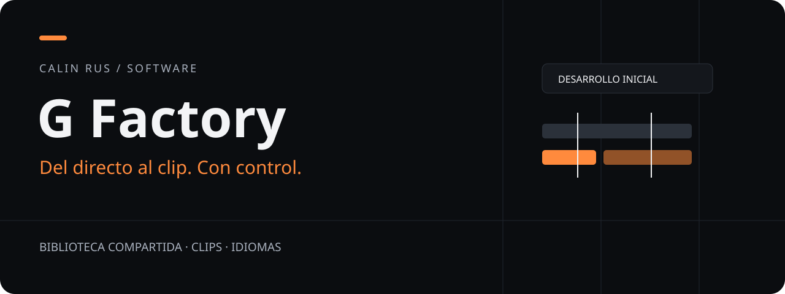
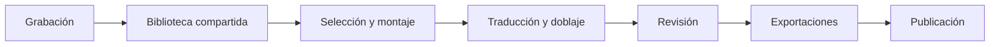

# G Factory / Del directo al clip. Con control.

**Un estudio privado de clips multilingües para trabajar entre dos personas.** La idea es conservar el recorrido completo: grabación, recorte, edición, doblaje, revisión y publicación. Abrirlo desde un móvil o un ordenador sin mover un stream entero a cada dispositivo.

**React · TypeScript · Python · Django · PostgreSQL · FFmpeg** — stack previsto.

## Desarrollo inicial

Hay documentación de arquitectura y un primer contrato de planificación implementado y probado. **Todavía no hay aplicación utilizable, editor visual, doblaje conectado ni uploader operativo.** Este showcase no anuncia una beta ni una descarga del producto.

La implementación principal permanece privada. Aquí publico una pieza pequeña que se puede ejecutar y revisar: el cálculo y validación de una línea de tiempo de recortes.

## Primero define qué vas a entregar

Un clip de quince minutos con cinco segundos de intro ya no dura quince minutos. El contrato cuenta el montaje completo, mantiene el orden de los cortes y rechaza rangos imposibles, números no finitos y versiones desconocidas.

[](https://github.com/calinrus-dev/g-factory-showcase/actions/workflows/verify.yml)

```sh
python -m unittest discover -s tests -v
python -m gfactory.plan examples/clip-plan.json
```

Python 3.12+. Sin dependencias, cuentas ni claves. El ejemplo representa dos fragmentos de una grabación ficticia de cuatro horas: 180 segundos de contenido y cinco de intro/outro. Resultado: **185 segundos**.

[Contrato ejecutable](gfactory/plan.py) · [Pruebas](tests/test_plan.py) · [Ejemplo](examples/clip-plan.json)

Esto valida un plan. No abre un vídeo, no hace cortes y no demuestra rendimiento de FFmpeg ni calidad de doblaje. [Origen y límites](docs/PROVENANCE.md).

## El recorrido previsto



- **Biblioteca común:** originales, clips, idiomas, versiones y resultados relacionados.
- **Trabajo desde cualquier lugar:** interfaz web oscura, adaptable al tacto y al escritorio.
- **Procesamiento central:** proxies para revisar; originales para renderizar.
- **Colaboración:** cambios de revisión explícitos para no sobrescribir el trabajo del otro.
- **IA intercambiable:** transcripción local y proveedores de voz evaluados por calidad, tiempo y coste.
- **Publicación controlada:** cola y programación; las pistas adicionales de YouTube requieren inicialmente un paso en Studio.

Todas estas funciones describen el diseño aprobado, no capacidades ya entregadas. [Arquitectura prevista](docs/ARCHITECTURE.md) · [Estado y siguientes pasos](docs/STATUS.md).

**Procesar menos veces el mismo material es una decisión de arquitectura. Afirmar que va rápido requiere medirlo.**

[Portfolio](https://github.com/calinrus-dev/portfolio) · [Calin Rus](https://github.com/calinrus-dev) · [LinkedIn](https://www.linkedin.com/in/calinrus-dev/)
